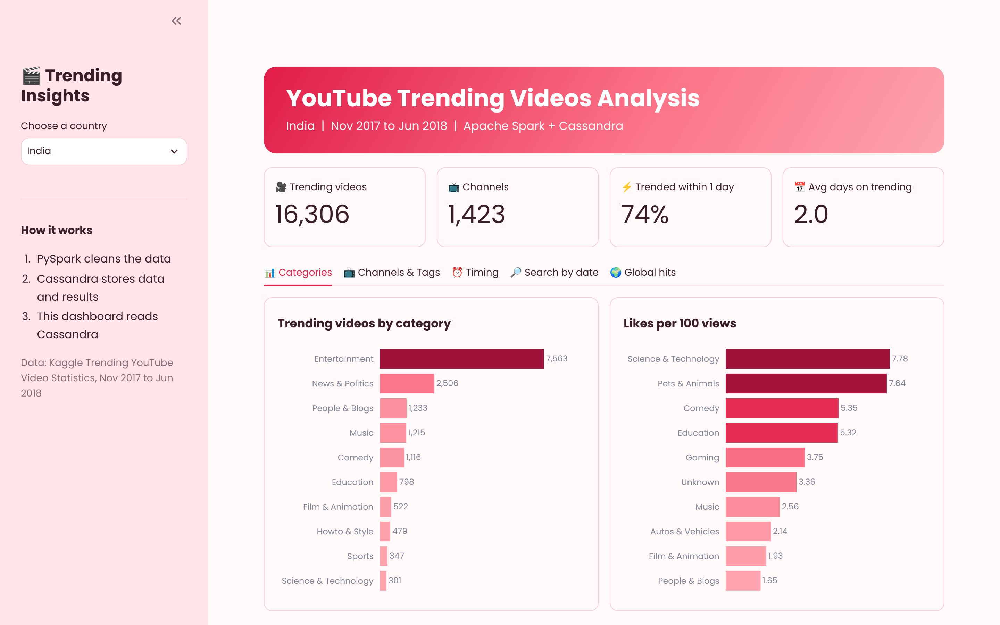

# YouTube Trending Videos Analysis using Apache Spark and Cassandra

A big data project that studies YouTube's daily trending videos in four countries. PySpark cleans and analyses the data, Apache Cassandra stores the data and the results, and a Streamlit dashboard shows everything as charts.

This is a descriptive analysis project. It does not predict anything.

## Team

| Name | Roll No. | GitHub |
|---|---|---|
| Dhanishtha Deshpande | 06 | @username |
| Himani Dalvi | 07 | @username |
| Palak Bhutada | 13 | @username |

**Guides:** Bhagyashree Madan, Sonam Chopade
**Course:** Big Data Analytics and Statistical Informatics Lab (LA2), Ramdeobaba University, Nagpur, 2026–27

## Dataset

[Trending YouTube Video Statistics](https://www.kaggle.com/datasets/datasnaek/youtube-new) from Kaggle.

- Countries: India, USA, Great Britain, Canada
- Period: 14 Nov 2017 to 14 Jun 2018 (205 days)
- Rows: 158,098 before cleaning, 152,794 after cleaning

The dataset is not in this repository because the files are large. Download it from the Kaggle link above.

## Tools

- PySpark 3.5.3 and Spark SQL
- Apache Cassandra 4.1.5 and Spark Cassandra Connector 3.5.1
- Streamlit and Plotly
- Google Colab

## How it works

1. **Dataset:** 4 CSV files and 4 category JSON files are kept in Google Drive.
2. **Spark:** loads all four countries, fixes the dates, removes duplicates and broken rows, and adds new columns.
3. **Cassandra:** stores the clean data in the table `trending_by_country`.
4. **Spark SQL:** runs 8 queries and saves each result in its own Cassandra table.
5. **Streamlit:** the dashboard reads these tables from Cassandra and shows the charts.

Cassandra primary key: `((country, trending_date), video_id)`. One country's list for one day is stored in one partition, so searching by date is fast.

## The 8 analyses

1. Top categories
2. Top channels
3. Days from upload to trending
4. Days a video stays on trending
5. Likes, dislikes and comments per 100 views
6. Upload day and hour
7. Top tags
8. Videos that trended in more than one country

## Key results

- A video stays on the trending list for about 2 days in India, but about 12 days in Great Britain.
- 74% of Indian videos started trending within one day of upload.
- Entertainment is the top category in India, USA and Canada. Music is top in Great Britain.
- 77 videos trended in all four countries.

## How to run

1. Download the dataset from Kaggle and put these 8 files in Google Drive at `MyDrive/BDA_Project/data`: `INvideos.csv`, `USvideos.csv`, `GBvideos.csv`, `CAvideos.csv`, `IN_category_id.json`, `US_category_id.json`, `GB_category_id.json`, `CA_category_id.json`.
2. Open `BDA_PROJECT.ipynb` in Google Colab.
3. Click **Runtime → Run all** and allow Google Drive access. It takes about 10 minutes.
4. Open the `trycloudflare.com` link printed by Cell 20 to see the dashboard.

## Files

| File | What it is |
|---|---|
| `BDA_PROJECT.ipynb` | Colab notebook with the full pipeline |
| `app.py` | Streamlit dashboard |
| `BDA_Project_Report.docx` | Project report |
| `BDA_Project_PPT.pptx` | Presentation |
| `dashboard.png` | Dashboard screenshot |
